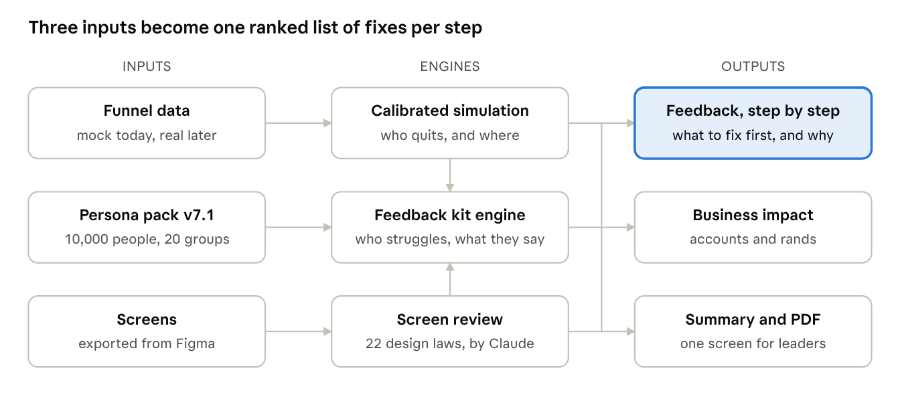

# Athena: testing designs with South Africa before we ship

Designed and built by Junior Sebilimetsa, Senior Product Designer, Standard Bank.

18 November 2026

## In one minute

Athena lets a design team put a flow in front of 10,000 synthetic South Africans before a single real customer sees it. It shows where people are likely to quit or struggle, who struggles most, what they would say about it, and what to fix first.

The synthetic customers come from a persona pack built on South African statistics: 20 archetypes weighted to stand for about 44 million adults. They differ in phone, data, documents, income, language, reading level, trust and patience, so a flow that works for a salaried iPhone user in Sandton but fails a grant recipient on a feature phone in rural Limpopo shows up before launch, not after.

Athena does not replace user research. It decides what research should test first, and it catches the obvious failures cheaply so real sessions can go deeper.

## Why the name

Athena is the Greek goddess of wisdom, strategy and craft. Three parts of that fit what the tool does:

- **Strategy before the battle.** Athena was the goddess of planned, considered campaigns, not brute force. The tool is about thinking a launch through before it meets customers.
- **Patron of craft.** She was the protector of weavers and makers. Product design is a craft, and this is a tool for the people who practise it.
- **The owl that sees in the dark.** Her owl stood for seeing what others miss. Athena shows a team what customers they rarely meet in research will go through: people on prepaid data, without proof of address, or reading in their second language.

It is also a short, memorable name that isn't tied to one product, which matters now that it tests any flow, not only account opening.

## The problem it solves

Most design problems are found too late, by too few people. A typical usability round sees five to eight participants, usually urban, connected and comfortable with apps. The customers a bank most often loses during onboarding are the ones least likely to be in that room.

- **Late discovery.** Problems surface in testing or after launch, when fixing them costs a sprint, not an afternoon.
- **Narrow samples.** A handful of participants can't show how a flow treats grant recipients, foreign nationals, older customers or people on feature phones.
- **Opinions over evidence.** Without numbers, design reviews turn into debates about taste, and the loudest view wins.
- **No line to the business.** Design teams struggle to say what a fix is worth, so it competes badly for roadmap time.

Athena moves the first round of discovery to before testing, across the whole population, with numbers attached.

## What it does

Athena takes three inputs, a funnel, a persona pack and the screens, and turns them into one answer per step: who quit, who struggled, why, and what to fix.

The simulation decides who quits where; the feedback engine and the screen review explain why, in customers' words and in design terms.

| View | What a team gets |
| --- | --- |
| Summary | One screen: how many people the flow loses, the two biggest leaks, the effect of a fix, a 3-month view and a confidence score. Exports to PDF. |
| Drop-off and ideas | Where people leave, screen by screen, with what they did and said. Switch ideas on to see their likely effect. |
| Customers | The 20 archetypes: who is in each group, what makes them quit, what they feel more than most, and real people from the pack. |
| Feedback | Step by step, from all 10,000: quit and struggle rates, what to fix (with a fix for each problem), what works, who struggles most, and three quotes. |
| Business impact | Accounts and money: today's flow against an improved one, with a 3-month projection. |
| Test a design | Upload screens from Figma, run them against today's flow or on their own, and get the same feedback. |

Inside Claude, two extras switch on: a **screen review** that checks each screen against 22 design laws and finds problems per step, and **Ask them again with Claude**, which rewrites the quotes as fresh answers in each person's voice.

## About the personas

The 20 archetypes are a behavioural framework for banking design, built on South African data rather than invented profiles.

1. **Built from national statistics.** Every one of the 10,000 people starts from published figures: population group, age, sex, province and language (Stats SA Census 2022 and 2026 mid-year estimates); work, household and grants (Quarterly Labour Force Survey, General Household Survey, SASSA's grant rules); and banking habits such as accounts, credit, savings, funeral cover, stokvels and financial vulnerability (FinScope Consumer South Africa 2025, NASASA). Across all 10,000, these match national figures to within a point or two.
2. **Given an archetype only if it fits.** A Grant Receiver is someone whose main income is a grant; an Informal Trader works in the informal sector. So each archetype is as common as that kind of customer really is, backed by FinScope MSME, the World Bank Global Findex and the NCR Credit Bureau Monitor.
3. **Then given a way of behaving.** Patience, trust, how people react to problems and what they say come from the persona feedback kit: 589 lines in everyday South African English. These are informed assumptions, not measured data.

| Matches national data | Informed assumptions |
| --- | --- |
| Who people are: population, age, province, language, work, income, grants, bank accounts, credit, savings, funeral cover and stokvels | How people behave: patience, trust, reactions to problems, and the feedback they give |

Athena is used to find likely problem areas and compare design options early. It complements real customer research; it doesn't replace it.

## Grounded in research

Athena stands on published South African statistics, established design laws and current guidance on synthetic research. Across all 10,000 personas, the pack matches national figures to within a point or two.

**Who South Africans are**

| Source | What it grounds in Athena | A figure from it |
| --- | --- | --- |
| [Stats SA, Mid-year population estimates 2026](https://www.statssa.gov.za/?p=19764) and Census 2022 | Population group, age, sex, province, home language | 63.5 million people in 2026 |
| [Stats SA, Quarterly Labour Force Survey](https://www.sanews.gov.za/node/85558) | Work and unemployment | Official unemployment of 33.7% in Q3 2026 |
| [Stats SA, General Household Survey](https://www.statssa.gov.za/publications/P0318/MEDIA%20RELEASE%20-%20%20GHS%202024.pdf) | Households and grants | 40.1% of people received a social grant in 2024 |
| [SASSA grant figures](https://www.joburgetc.com/?p=57478) | Grant types and who qualifies | 19.2 million regular grant beneficiaries in March 2025, plus over 9 million on the SRD grant |
| [FinScope Consumer South Africa 2025](https://finmark.org.za/Publications/FinScope_2025_Launch.pdf) | Accounts, credit, savings, funeral cover, financial vulnerability | 89% of adults hold a personal bank account |
| [NASASA](https://www.ewn.co.za/more-than-11-million-south-africans-are-members-of-stokvels-nasasa) | Stokvel membership | More than 11 million members |
| [ICASA, State of the ICT Sector 2025](https://www.icasa.org.za/uploads/files/The-State-of-the-ICT-Sector-Report-of-South-Africa-2025.pdf) | Phones, data and prices | 82.7 million smartphone subscriptions in 2024 |

**Support for the archetypes**

| Source | What it supports |
| --- | --- |
| [FinScope MSME South Africa 2024](https://www.finmark.org.za/knowledge-hub/articles) | Informal traders, township entrepreneurs and side hustles |
| [World Bank Global Findex 2025](https://microdata.worldbank.org/catalog/7977/related-materials) | How people use accounts, save and pay digitally |
| [NCR Credit Bureau Monitor](https://www.ncr.org.za/documents/CBM/CBM%20Q2%202025.pdf) | Credit standing and arrears: 29.24 million credit-active consumers in June 2025 |

**How people use screens**

| Source | What it grounds in Athena |
| --- | --- |
| [Laws of UX, Jon Yablonski](https://lawsofux.com/) | Most of the 22 design laws in the screen review: Hick's, Miller's, Fitts's, Jakob's, Tesler's and Postel's laws, the Doherty threshold, the goal-gradient, Zeigarnik and peak-end effects |
| Jan Carlzon, *Moments of Truth* (1987), and Google's [*Winning the Zero Moment of Truth*](https://agency.googleblog.com/2011/06/zero-moment-of-truth-new-marketing.html) (Jim Lecinski, 2011) | The moment-of-truth checks: the zero, first and second moments a customer decides to trust, start and keep using the account |
| [W3C, WCAG 2.2](https://www.w3.org/WAI/news/2023-10-05/wcag22rec) (Recommendation, October 2023) | The inclusive design check: large text, contrast, touch targets and screen readers |

**How to use synthetic research well**

| Source | What it means for Athena |
| --- | --- |
| [Nielsen Norman Group, *Why you only need to test with 5 users*](https://nngroup.com/articles/why-you-only-need-to-test-with-5-users/) | Five users is enough only when users are alike. With very different groups, as in South Africa, each group needs testing. Athena shows which groups to recruit. |
| [Nielsen Norman Group, *Synthetic Users: If, When, and How to Use AI-Generated Research*](https://nngroup.com/articles/synthetic-users/) | Synthetic users should complement real research, not replace it, and suit hypotheses rather than final decisions. Athena is built and labelled that way. |

## For product design teams

Athena gives designers evidence early, in the language they work in: screens, steps and fields.

- **Find problems before testing.** Run a Figma flow in minutes and arrive at research with the obvious failures already fixed.
- **Know what to fix first.** Each step lists its problems worst first, with the share of people affected and a concrete fix, down to the field people get stuck on.
- **Design for everyone, not the average.** See which customers a step fails ("2.2 times more likely to leave here than average") and check that a design hasn't forgotten a group.
- **Hear the customer.** Three quotes per step, in each person's voice, make a finding concrete in a crit or a stakeholder review.
- **Compare options fairly.** Test concept A against concept B, or a new flow against today's, on the same 10,000 people.
- **Ground design laws in customers.** The screen review ties laws like Hick's law or the moment of truth to the step where they break, next to what customers said there.
- **Sharper research.** Use the findings to choose who to recruit and which steps to probe, so real sessions answer the questions synthetic ones can't.

## For business objectives

Athena links design decisions to the numbers the business already tracks.

| Objective | How Athena helps |
| --- | --- |
| Grow accounts opened | Finds the steps where most applicants are lost and estimates what a fix recovers, so teams fix the biggest leaks first. |
| Lower cost to acquire | Every applicant who quits halfway was paid for in marketing. Fewer drop-offs mean more accounts from the same spend. |
| Spend delivery time well | Gives each fix a likely effect in accounts and rands, so roadmap trade-offs rest on evidence, not taste. |
| Reach underserved customers | Shows how a flow treats grant recipients, rural customers, foreign nationals and feature-phone users, the groups financial inclusion goals depend on. |
| Reduce launch risk | Catches failures before build and release, when they're cheapest to fix, and gives leaders a confidence score before sign-off. |
| Cut branch and call-centre load | Highlights steps that push people to a branch or a call ("I'll go to the branch"), which the app was meant to replace. |

All funnel and rand figures in Athena today are mock data. Once connected to real funnel data, the same views report the bank's own numbers.

## How a team uses it

From exported screens to a ranked list of fixes, in six steps.

1. **Export the flow.** Export the screens from Figma as PNGs, in order.
2. **Add them to Athena.** Upload them under Test a design, name each step and say what it does. Choose to compare against today's flow or test it on its own.
3. **Review the screens.** Press Review with Claude. Each screen is checked against the design laws and its likely problems are tagged by severity.
4. **Read the feedback.** Open the Feedback tab and start with the steps marked Most quit and Hardest. Read what to fix, who struggles and the three quotes.
5. **Fix and rerun.** Change the design, upload again and compare. Repeat until the confidence score clears the bar.
6. **Take it to real people.** Recruit the groups that struggled most and probe the steps Athena flagged. Feed what you learn back into the persona pack and the feedback bank.

## What it is not

Athena is a simulation, not research, and it labels its synthetic feedback as such.

- **Synthetic people, not customers.** The quotes are generated from a bank of written lines and each person's traits. They show likely reactions, not real ones.
- **Assumptions to tune.** How strongly each group feels each problem, the effect of each idea and the confidence score's weights are starting assumptions. They should be checked against real test results and adjusted.
- **Mock numbers today.** Funnel and rand figures are mock data until Athena is connected to the bank's own figures.
- **A screen review is a first pass.** Claude sees images, not a working prototype, so timing, motion and error handling need a real prototype or a real session.
- **Only as broad as its bank.** A new kind of screen needs new feedback lines. The best source is real interview notes, rewritten and stripped of names.

Used well, Athena makes research faster and better aimed. It doesn't make it unnecessary.

## Where to find it and what's next

- **Try it:** the [live simulator](https://claude.ai/artifact/4Mh9p7WBX4d5tqbv7AaE3w), or open `simulator.html` from this repository. The screen review and Ask them again with Claude work when it's opened in Claude.
- **Code and data:** this repository, with the [persona pack](../data/), the [feedback kit](../kit/README.md) and the [methodology](methodology.md).

Proposed next steps:

- [ ] Connect Athena to real funnel data for one account, replacing the mock figures
- [ ] Run one live project through it, then compare its findings with that project's usability sessions
- [ ] Tune the persona and feedback assumptions against those sessions
- [ ] Add feedback lines for the next flows to test, such as payments and stokvels
- [ ] Agree where Athena sits in the design process, for example as a gate before user testing
